# 12-week Java backend roadmap

## Priorities and boundaries

1. Pass AGH courses and submit work in the required language, tools, and format.
2. Build one application you can explain, test, and run from a clean checkout.
3. Maintain IBM Data Science progress without competing with urgent coursework.
4. Prepare for internships through small coding exercises, SQL, project explanations, and applications.

The horizon is **240 hours at 20 hours/week**: B 144, I 48, A 48 before deadline adjustments. This is a planning budget, not a promise to finish several certificates. Weeks are relative to your chosen start. Enter planned Start date/Target date in the Project and verified academic Deadline separately; record capacity in PROGRESS.md.

No complete exercise solutions are included. No application is scaffolded in this phase. Avoid adding microservices, Kubernetes, Kafka, reactive programming, a large frontend, or AI features during the core plan.

## Tracking with GitHub

Use [TASKS.md](TASKS.md) to open weekly GitHub issues and repository milestones. Issues hold daily checklists/evidence; GitHub Projects supplies Board, Table, and Roadmap views. See [GITHUB_PROJECTS.md](GITHUB_PROJECTS.md) for free setup and the explicit Projects-permission step. No custom learning-tracker application is required.

The learning content stays here and in the weekly Markdown. Track live execution in issues rather than duplicating checkbox updates across tools. Weekly repository milestones indicate the scheduled week; issue titles retain the original curriculum week when work is rescheduled.

## Configure capacity and protect AGH work

For weekly capacity H, start with B = 0.60H, I = 0.20H, A = 0.20H. Daily tables below total 20 hours; multiply estimates by H/20, then reduce scope to fit. Smaller time boxes do not make all deliverables equally achievable. Keep prerequisite order and move a feature to a later week when needed.

At the weekly review, estimate mandatory AGH work from actual briefs. If that estimate is R hours, set A to at least R and divide remaining time B:I approximately 3:1. Example: H=20, A=10 gives B=7.5 and I=2.5. For an exam week, A=16, B=3, I=1 is reasonable. If required work exceeds H, pause optional tracks and revise capacity/deadlines honestly; do not keep a fictional 20-hour plan.

| Day | B | I | A | Total |
| --- | ---: | ---: | ---: | ---: |
| 1 | 2h | — | 1h | 3h |
| 2 | 2h | 1h | — | 3h |
| 3 | 2h | — | 1h | 3h |
| 4 | 2h | 1h | — | 3h |
| 5 | 2h | — | 1h | 3h |
| 6 | 1h | 2h | 1h | 4h |
| 7 | 1h review | — | — | 1h |
| Total | 12h | 4h | 4h | 20h |

Split the four-hour day into separate blocks. University deadlines may change this distribution. Every daily item has a completion criterion; a time box ending with unfinished work is recorded as partial, not passed.

## One evolving application: Study Task Tracker

Build a small personal study planner. Domain: `Course` and `StudyTask`. A task has an identifier, title, status (`TODO`, `IN_PROGRESS`, `DONE`), optional due date, and eventually a course. Use synthetic sample data. Treat the initial application as single-user and local.

Evolution:

1. Week 01: Java objects and rules tested without a web framework.
2. Week 02: reuse those concepts in a small Spring Boot HTTP API backed by memory.
3. Week 03: replace memory storage with PostgreSQL through JPA; use migrations from the first persistent schema.
4. Weeks 04–06: course relationship, validation, error contract, transactions, filters, pagination, and meaningful tests.
5. Weeks 07–09: reproducible Docker environment, CI checks, operational basics, and deployment rehearsal.
6. Weeks 10–12: documentation, modest data analysis from an export, interview practice, and portfolio release.

Do not restart the application at each course. Small AGH exercises and IBM notebooks remain separate learning artifacts; they do not become extra portfolio backends.

### Proposed API contract to refine while learning

| Operation | Planned behavior | First target |
| --- | --- | --- |
| `GET /api/tasks` | 200 and a JSON list; an empty collection is valid | Week 02 |
| `POST /api/tasks` | 201, created task, and a Location header | Week 02 |
| `GET /api/tasks/{id}` | 200 or 404 for a missing numeric ID | Week 02 |
| `PATCH /api/tasks/{id}/status` | 200 with updated task; 400 for an invalid status; 404 if absent | Week 02 |
| `DELETE /api/tasks/{id}` | 204 if deleted; 404 if absent | Week 04 |
| `POST /api/courses`, `GET /api/courses` | Create and list courses; require an existing course when linking a task | Week 04 |
| `GET /api/tasks?status=TODO&page=0&size=10` | Filtered, stably ordered page with documented metadata | Week 06 |

Keep the list response simple initially; document the planned pagination contract change in Week 06. Week 02 errors can be minimal. Week 04 standardizes them. Invalid JSON, blank titles, and unknown statuses must eventually produce 400, never an unhandled 500.

### Technology choices

- Use the AGH-required JDK for coursework. For the portfolio, Java 21 is a reasonable baseline **if compatible with the selected supported Spring Boot release**; record the exact versions at setup. Check [Spring requirements](https://docs.spring.io/spring-boot/system-requirements.html).
- Select a stable supported Spring Boot release at Week 02 setup; avoid snapshots. Let its dependency management select compatible testing and persistence libraries. Course examples and current docs can use different major versions: match documentation to the chosen version rather than mixing imports.
- Use Maven and its wrapper, JUnit Jupiter, Mockito where isolation is useful, Spring MVC, Spring Data JPA, PostgreSQL, Flyway migrations, Git, and Docker Compose. Begin with a local PostgreSQL installation or a database-only container; containerize the complete app later.
- Record exact Java, Spring Boot, PostgreSQL, Maven, and container versions. Keep the chosen versions stable while learning unless a concrete compatibility or maintenance issue requires a change.

These are learning-plan choices. Current capabilities and version requirements come from the official references in [RESOURCES.md](RESOURCES.md).

## Prerequisite gates

| Gate | Demonstrate without copying | If not ready |
| --- | --- | --- |
| G0: initial baseline, Week 01 Day 1 | Compile/run a tiny Java program; distinguish class, object, constructor, instance method, static method; identify your next AGH deadline | Use actual failed examples to choose Java review; do not repeat all beginner videos |
| G1: Spring entry, Week 01 end | Create/use a class and constructor; implement an interface; use `List<StudyTask>` and a map or equivalent lookup; handle missing/invalid data; run at least 4 meaningful JUnit tests; explain a Maven dependency and one GET/POST example | Spend Week 02 Day 1's first 30 minutes rechecking; if still blocked, replace its first 2h backend block with targeted Java repair, then reassess. Shift Spring by one or two sessions. Delay SQL/previews before skipping the gate |
| G2: persistence, Week 02 end | Demonstrate create/read/status HTTP flow; explain controller → service → repository; explain PK/FK, parameterized SQL, and one join | Repair the failing slice before adding JPA relationships |
| G3: reproducible backend, Week 08 end | Verify tests against PostgreSQL and start app+DB with documented commands; CI must actually run database integration tests | Fix reproducibility before deployment or additional features |
| EPAM Java Readiness, target Week 11 | Independent assessment A/B evidence for Java, collections/generics, functional Java, I/O, algorithms, Maven/JUnit, SQL and Spring; follow [rubric](EPAM_READINESS.md) | Use W12 D5 retry or defer the checkpoint; never override AGH deadlines or reset completed work |
| G4: portfolio, Week 12 | Fresh checkout works, demo succeeds, limitations are documented, and you can explain design/test choices | Report remaining gaps and plan another focused iteration |

No mastery of every Java feature is required before Spring. Keep the G1 entry gate and Week 02 start; explicit generics, lambda, stream, I/O and algorithm practice follows in the existing backend slots. Framework internals and advanced concurrency remain later topics.

## EPAM alignment inside the same hours

[EPAM Java Readiness](EPAM_READINESS.md) maps the official guidance to this curriculum, names the gaps, and defines practical assessments. Strengthen Core Java/OOP first, then make collections/generics (W03), lambdas (W04), streams (W05), I/O (W06), and algorithms (W07–08) explicit. Maven/JUnit, SQL and Spring stay integrated with the same evolving application. Use the current Java course and official references only for demonstrated gaps; no extra course is added.

The assessment replaces W11 D3–4 interview/walkthrough slots; W12 D5's existing mock hour becomes a targeted retry. The [substitution ledger](EPAM_READINESS.md#workload-substitutions) explains each exchange. Weekly totals remain B12/I4/A4, subject to mandatory AGH work. Earlier completed tasks stay completed; new gaps use future repair time. The readiness tracker is an evidence index with Estimate 0h.

EPAM's roadmap is broader than an entrance-test syllabus, and its curriculum varies by location/course. These assessments are our benchmark, not official questions or a published EPAM pass score. Verify your actual intake and eligibility before applying. Later enterprise/cloud/AI specializations are deferred.

## Twelve-week map

Each linked file follows the daily budget above. Its daily rows are the task outline and measurable evidence; this table is the milestone view.

| Week | Backend outcome / checkpoint | IBM Data Science direction, 4h | AGH default preparation, 4h |
| --- | --- | --- | --- |
| [01](weeks/week-01.md) | Core Java/OOP diagnostic, typed collections, Maven, at least 4 tests, G1 | Current unit baseline; Python/notebook fundamentals as needed | Inventory live briefs; Bash, current OOP exercise, HTML/CSS, database joins |
| [02](weeks/week-02.md) | In-memory Spring API, DI/annotations and SQL; create/read/status demo, G2 | Python collections/files and a small reproducible data exercise | Processes, OOP, JS/forms, SQL |
| [03](weeks/week-03.md) | PostgreSQL + migration + JPA; collections/equality and generics | pandas loading/filtering and summary statistics | Threads and shared state; OOP collections; Flask routing; keys/normalization |
| [04](weeks/week-04.md) | Relationship, validation, 400/404 contract, delete; functional interfaces/lambdas | Missing values, cleaning, and SQL overlap | IPC; OOP exceptions; Flask requests/templates; joins/aggregates |
| [05](weeks/week-05.md) | Mockito, PostgreSQL integration/rollback; streams versus loops | SQL/data-access lab or current certificate unit | Synchronization; OOP interfaces/equality; Flask tests; transactions |
| [06](weeks/week-06.md) | Filters/pagination, transactions/query inspection; UTF-8 I/O/resources | Visualization with a concrete question | Deadlocks; OOP review; Flask REST; indexes/query plans |
| [07](weeks/week-07.md) | App + PostgreSQL Compose; algorithm/complexity and Java gap repair | Descriptive statistics and exploratory analysis | Memory; Java review; responsive JS UI; schema exercise |
| [08](weeks/week-08.md) | CI with real PostgreSQL tests, G3; algorithm and bounded thread review | Data leakage/split concepts if ready; otherwise current unit | Virtual memory; OOP exam practice; Flask/cloud requirements; SQL mock |
| [09](weeks/week-09.md) | Deployment/logs/restore rehearsal; Core Java diagnostic and CV | Evaluation or current certificate lab | Filesystems; Java mock; actual Flask deployment assignment; database recovery concepts |
| [10](weeks/week-10.md) | Security/API docs/demo; targeted Java repair and project explanation | Analyze a small synthetic app export with pandas | Sockets; OOP weak area; Flask/REST weak area; database weak area |
| [11](weeks/week-11.md) | Feature freeze/fixes/CV; **EPAM Java Readiness A/B**, evidence review | Reproducible notebook and honest conclusions | OS security; actual exam/lab priorities for other subjects |
| [12](weeks/week-12.md) | Clean-checkout release/demo, G4; targeted readiness retry if needed | Consolidation and next certificate milestone | Mixed retrieval/mock assessment and remaining submission checks |

## Keep AGH aligned with reality

The topic order above is provisional. It is **not an AGH lecture calendar**. Each week, enter the current exercise number, lecture topic, submission date, required tools/language, source/rubric, and definition of done in PROGRESS.md. Use the four A slots for the earliest mandatory work, even if that means one subject uses all four hours.

Local context inspected on 2026-10-22, as starting pointers only:

| Subject | Local evidence | Initial preparation question |
| --- | --- | --- |
| OOP Java | `~/Desktop/Java_Project/lab_2/task_1/Client.java`; `lab_3/TASK_3.txt` describes a sports-store console task dated October 20 | Can you trace initialization/constructors and independently check loop, input, and discount-boundary behavior? |
| Operating Systems | `~/Desktop/OperatingSystems/lab1/task1.txt`, Bash exercises, `race.sh` | Can you explain pipelines, quoting, permissions, and process behavior rather than only rerun scripts? |
| Web technologies | `~/Desktop/WebAppTech/lab02/README.md` describes HTML/CSS, a POST form, and remaining verification items | What does the current rubric require and what still needs your verification? |
| Databases I | `~/Desktop/Base_Lab_Complete/README.txt` describes a Countries/Cities Base lab, keys, joins, forms, and reports | Can you explain INNER versus LEFT JOIN and produce the required submission evidence? |

These paths are optional local pointers and will not exist on another machine. File names and existing notes do not establish grading, submission, or current completion. Deadlines and the latest lecture briefs have not been verified. Check UPEL/Teams/lecturer materials yourself and record the authoritative source. Preserve required Base/HSQLDB or other course tooling when assigned; PostgreSQL practice does not replace it.

**Flask assignments stay in Flask.** Use selected IBM Python/Flask sections for Python modules, routing, templates, HTTP requests, testing, and required deployment. Spring Boot does not satisfy those assignments. Follow the required language for OS labs too; do not replace required C/POSIX work with Java or Bash.

If no deadline is urgent, split A across OS, Java, web, and databases. If a future lecture topic is not yet assigned, use it for retrieval questions or a tiny experiment; never invent a submission requirement.

## Testing and proof of progress

| Layer | Start | Evidence to collect |
| --- | --- | --- |
| Domain/service unit | Week 01 | Normal, boundary, invalid-input, and missing-ID behavior; tests run from terminal |
| HTTP/controller | Week 02 | JSON and status assertions, including negative cases; match the selected Spring test API |
| Database integration | Week 03 | Actual PostgreSQL schema/migrations, saved/reloaded record, constraint failure; mocks alone do not count |
| Service isolation | Week 05 | Mockito isolates a repository dependency; assert behavior, avoid testing framework internals |
| Transactions/queries | Weeks 05–06 | Forced rollback leaves no partial update; pagination and filters have deterministic results |
| Reproducibility/CI | Weeks 07–08 | Clean environment starts with documented commands; CI reports include database tests, not just unit tests |
| Deployment smoke | Week 09 | Exact revision, start command, HTTP result, restart persistence, and restored backup in a disposable DB |

Choose a small Maven verification workflow and document it. `./mvnw test` is useful once a wrapper exists; `./mvnw verify` should become the documented command for the full suite by Week 08. Configure integration-test discovery explicitly and check reports so a green build cannot silently skip those tests. Do not optimize for arbitrary test counts or coverage percentages; the early minimum counts ensure basic practice, then scenario coverage matters more.

## Courses without tutorial overload

Use Amazon Java selectively in Week 01 and for later gaps. Start Amazon Spring sections in Week 02 without waiting for the database course to finish. Select Amazon SQL/JDBC sections in Weeks 01–03 and relevant persistence/transaction topics afterward. The course mapping and official references are in RESOURCES.md.

Use one course explanation plus one official reference per problem. Skip duplicate explanations after demonstrating the skill. If you need a certificate, complete its required assessments within the same budget or extend the schedule; independent evidence does not automatically waive provider requirements. IBM Linux and Flask are A-track support, not two new full-time courses. IBM Data Science remains I-track work. Record overlap once and avoid repeating a whole SQL/Python/Git unit unnecessarily, while respecting certificate assessment rules.

At 48 scheduled IBM hours, target a documented baseline and consistent lab progress. Depending on your enrollment point, some later topics in the table may remain previews. If the current unit takes longer, continue it and defer later previews. Do not jump to modeling simply because the calendar says Week 08.

## Internship practice within the backend budget

- Weeks 01–02: explain your code aloud, use small commits, identify one strengths/gaps list.
- Weeks 03–06: one small Java data-structure problem and one SQL question per week, time-boxed in the daily plan. Explain edge cases and time/space cost.
- Weeks 07–08: use small algorithm attempts and the short project walkthrough; retain live role research in Week 11 rather than repeat it here.
- Weeks 09–10: draft a one-page CV and describe one feature with evidence: what it does, how it is tested, and what you learned.
- Weeks 11–12: complete the bounded [EPAM readiness assessments](EPAM_READINESS.md#practical-assessments) and retry gaps; cover Java/OOP, collections/generics, lambdas/streams, I/O, algorithms, HTTP/DI, SQL, Maven and tests. Prepare two short stories about debugging and tradeoffs. Apply to a small number of suitable live openings; log them and verify eligibility/deadlines. Application and publication actions remain yours to perform.

## Deployment and scope control

Core target: a local deployment rehearsal using the packaged/containerized app and PostgreSQL on Ubuntu. Check configuration, health, logs, restart persistence, backup restoration, and a previous application revision against a compatible schema. This is valid deployment practice even without a paid cloud account.

Hosted deployment is a Week 09 replacement task only if local reproducibility is already sound and the time/budget fits. Use synthetic data, check provider limits at that time, document the URL and revision, and protect write access before public exposure. Do not design custom cryptography or a JWT system for this roadmap. Keep a private/local demo if authentication or hosting would consume the remaining budget. Complete any AGH-required Flask/cloud deployment separately according to its rubric.

Core scope wins over stretch work. Stretch candidates, only by replacing other optional work: API documentation tooling, hosted read-only demo, one richer query, an extra integration test. Do not add a second backend or elaborate frontend.

## Weekly adjustment rules and exit criteria

Use the review in PROGRESS.md. A checkpoint is passed only with a reproducible result and a short independent explanation. If it fails, name the exact missing behavior and dedicate the next backend block to it. Reduce breadth before increasing hours. If you finish early, add an edge case or explain a design choice before opening another course.

By Week 12, aim to demonstrate:

- [ ] AGH submissions tracked against real deadlines and required evidence; unresolved items visible.
- [ ] One Java/Spring application with PostgreSQL, migrations, documented API, validation/errors, and tested behavior.
- [ ] Unit, HTTP, and PostgreSQL integration tests run through the documented verification command and CI.
- [ ] Docker/local deployment works from a clean checkout; persistence and restore checks recorded.
- [ ] A five-minute demo, clear README, one-page CV, interview practice, and a small application log.
- [ ] IBM notebook/lab progress recorded honestly, including unfinished certificate units.
- [ ] EPAM readiness assessed with original attempts and evidence; unresolved skill gaps remain visible and scheduled.

After this cycle, consider Google ML Crash Course within the I budget **instead of adding more weekly hours**, once Python functions/collections, NumPy/pandas basics, algebra/functions, basic linear algebra, and descriptive statistics are comfortable. Use the [official prerequisite checklist](https://developers.google.com/machine-learning/crash-course/prereqs-and-prework). If those foundations or AGH work are weak, continue them first. No AI component is needed in the Java application to make progress toward AI/ML engineering.

## Learning dependencies

These dependencies apply to backend milestones. IBM Data Science and current AGH work run in parallel; AGH deadlines take priority. Verify checkpoint evidence before expanding backend scope.

```mermaid
flowchart LR
  subgraph Backend["Java / Backend — 60%"]
    W1["W01 · Core Java + OOP · G1"]
    W2["W02 · Spring API + SQL · G2"]
    W3["W03 · Persistence + generics"]
    W4["W04 · Validation + lambdas"]
    W5["W05 · Tests + streams"]
    W6["W06 · Queries + I/O"]
    W7["W07 · Docker + algorithms"]
    W8["W08 · CI + algorithms/threads · G3"]
    W9["W09 · Deployment + Java diagnostic"]
    W10["W10 · Portfolio + gap repair"]
    W11["W11 · Readiness A/B + review"]
    W12["W12 · Release + targeted retry · G4"]
    W1 --> W2 --> W3 --> W4 --> W5 --> W6 --> W7 --> W8 --> W9 --> W10 --> W11 --> W12
  end
  subgraph Skills["Skill prerequisites — practise in the weekly slots"]
    CORE["Core Java + OOP + exceptions"]
    TYPES["Typed collections + generics"]
    FN["Functional interfaces + lambdas"]
    STREAM["Streams"]
    IO["I/O + resource handling"]
    ALG["Data structures + algorithms"]
    TOOLS["Maven + JUnit"]
    HTTP["HTTP + DI + Spring"]
    SQL["SQL before persistence"]
    READY["EPAM Java Readiness · evidence checkpoint · 0 extra hours"]
    CORE --> TYPES --> FN --> STREAM
    CORE --> IO
    TYPES --> ALG
    CORE --> TOOLS
    CORE --> HTTP
    SQL --> W3
    STREAM --> READY
    IO --> READY
    ALG --> READY
    TOOLS --> READY
    HTTP --> READY
    SQL --> READY
    W11 --> READY
    READY -. "if gaps remain: targeted retry" .-> W12
  end
  subgraph Parallel["Parallel learning"]
    DS["IBM Data Science · 20% · current unit"]
    AGH["AGH · 20% baseline · actual deadlines first"]
    ML["Google ML · later · Python/data/math gate"]
    DS -. "after foundations + capacity review" .-> ML
  end
  AGH -. "reallocate study time when required" .-> W1
  classDef backend fill:#123d31,stroke:#5ee2b7,color:#e6fff6;
  classDef data fill:#242147,stroke:#b7a2ff,color:#f0eaff;
  classDef agh fill:#422e18,stroke:#edbc73,color:#fff2dd;
  class W1,W2,W3,W4,W5,W6,W7,W8,W9,W10,W11,W12,CORE,TYPES,FN,STREAM,IO,ALG,TOOLS,HTTP,SQL,READY backend;
  class DS,ML data;
  class AGH agh;
```

The week chain is the application sequence; the skill branches show prerequisites without delaying Spring until streams or I/O are mastered. The readiness node indexes existing assessment work, not another work package. See [live tracker](TASKS.md#epam-java-readiness) and [Projects scheduling](GITHUB_PROJECTS.md#epam-readiness-in-your-existing-project).
