# All 12 weeks

[Home / current week](README.md) · [Materials](RESOURCES.md) · [Learning dependencies](#learning-dependencies)

## All weeks

Choose a week below. **Issues are the tasks and progress record**; expandable curriculum supplies context. Original curriculum weeks stay fixed here; an issue's current milestone is its rescheduled week. [Live milestones](https://github.com/ivanshevchuk0/java-backend-roadmap/milestones) preserve the schedule/history.

| Curriculum week | Java / backend outcome | Existing tasks — open directly |
| --- | --- | --- |
| [Week 01](#week-01) | Core Java/OOP diagnostic, typed collections, Maven, at least 4 tests, G1 | [Java #1](https://github.com/ivanshevchuk0/java-backend-roadmap/issues/1) · [IBM #2](https://github.com/ivanshevchuk0/java-backend-roadmap/issues/2) · [AGH #3](https://github.com/ivanshevchuk0/java-backend-roadmap/issues/3) |
| [Week 02](#week-02) | In-memory Spring API, DI/annotations and SQL; create/read/status demo, G2 | [Java #4](https://github.com/ivanshevchuk0/java-backend-roadmap/issues/4) · [IBM #5](https://github.com/ivanshevchuk0/java-backend-roadmap/issues/5) · [AGH #6](https://github.com/ivanshevchuk0/java-backend-roadmap/issues/6) |
| [Week 03](#week-03) | PostgreSQL + migration + JPA; collections/equality and generics | [Java #7](https://github.com/ivanshevchuk0/java-backend-roadmap/issues/7) · [IBM #8](https://github.com/ivanshevchuk0/java-backend-roadmap/issues/8) · [AGH #9](https://github.com/ivanshevchuk0/java-backend-roadmap/issues/9) |
| [Week 04](#week-04) | Relationship, validation, 400/404 contract, delete; functional interfaces/lambdas | [Java #10](https://github.com/ivanshevchuk0/java-backend-roadmap/issues/10) · [IBM #11](https://github.com/ivanshevchuk0/java-backend-roadmap/issues/11) · [AGH #12](https://github.com/ivanshevchuk0/java-backend-roadmap/issues/12) |
| [Week 05](#week-05) | Mockito, PostgreSQL integration/rollback; streams versus loops | [Java #13](https://github.com/ivanshevchuk0/java-backend-roadmap/issues/13) · [IBM #14](https://github.com/ivanshevchuk0/java-backend-roadmap/issues/14) · [AGH #15](https://github.com/ivanshevchuk0/java-backend-roadmap/issues/15) |
| [Week 06](#week-06) | Filters/pagination, transactions/query inspection; UTF-8 I/O/resources | [Java #16](https://github.com/ivanshevchuk0/java-backend-roadmap/issues/16) · [IBM #17](https://github.com/ivanshevchuk0/java-backend-roadmap/issues/17) · [AGH #18](https://github.com/ivanshevchuk0/java-backend-roadmap/issues/18) |
| [Week 07](#week-07) | App + PostgreSQL Compose; algorithm/complexity and Java gap repair | [Java #19](https://github.com/ivanshevchuk0/java-backend-roadmap/issues/19) · [IBM #20](https://github.com/ivanshevchuk0/java-backend-roadmap/issues/20) · [AGH #21](https://github.com/ivanshevchuk0/java-backend-roadmap/issues/21) |
| [Week 08](#week-08) | CI with real PostgreSQL tests, G3; algorithm and bounded thread review | [Java #22](https://github.com/ivanshevchuk0/java-backend-roadmap/issues/22) · [IBM #23](https://github.com/ivanshevchuk0/java-backend-roadmap/issues/23) · [AGH #24](https://github.com/ivanshevchuk0/java-backend-roadmap/issues/24) |
| [Week 09](#week-09) | Deployment/logs/restore rehearsal; Core Java diagnostic and CV | [Java #25](https://github.com/ivanshevchuk0/java-backend-roadmap/issues/25) · [IBM #26](https://github.com/ivanshevchuk0/java-backend-roadmap/issues/26) · [AGH #27](https://github.com/ivanshevchuk0/java-backend-roadmap/issues/27) |
| [Week 10](#week-10) | Security/API docs/demo; targeted Java repair and project explanation | [Java #28](https://github.com/ivanshevchuk0/java-backend-roadmap/issues/28) · [IBM #29](https://github.com/ivanshevchuk0/java-backend-roadmap/issues/29) · [AGH #30](https://github.com/ivanshevchuk0/java-backend-roadmap/issues/30) |
| [Week 11](#week-11) | Feature freeze/fixes/CV; **EPAM Java Readiness A/B**, evidence review | [Java #31](https://github.com/ivanshevchuk0/java-backend-roadmap/issues/31) · [IBM #32](https://github.com/ivanshevchuk0/java-backend-roadmap/issues/32) · [AGH #33](https://github.com/ivanshevchuk0/java-backend-roadmap/issues/33) |
| [Week 12](#week-12) | Clean-checkout release/demo, G4; targeted readiness retry if needed | [Java #34](https://github.com/ivanshevchuk0/java-backend-roadmap/issues/34) · [IBM #35](https://github.com/ivanshevchuk0/java-backend-roadmap/issues/35) · [AGH #36](https://github.com/ivanshevchuk0/java-backend-roadmap/issues/36) |

IBM continues its current unit for 4h/week; AGH's 4h baseline follows actual briefs and expands when deadlines require it. Each week has 12h backend / 4h IBM / 4h AGH before those adjustments. No task or milestone is recreated.

## Weekly curriculum

These are reference instructions, not a second set of completion checkboxes. Mark progress in the linked issues. Only expand the week you need.

## Week 01

Java foundation and a small tested model — expand curriculum

**Budget:** B 12h / I 4h / A 4h = 20h. This is curriculum reference, not generated application code. Day numbers are movable sessions. Every task's estimate includes its short evidence log. Check real deadlines first and replace A tasks when needed.

**Outcome:** explain your model, manipulate tasks in a collection, handle invalid/missing data, and run at least four meaningful JUnit tests. This is enough to attempt Spring in Week 02; advanced Java topics can follow later.

**Entry:** basic Java syntax and terminal familiarity. No course completion required. Use existing AGH exercises for diagnostics rather than starting from zero.

**Materials cap:** about 2h of passive Java/course/reference material across the 12 B hours. Read only relevant Amazon Java/Dev.java/Maven/JUnit sections. All explanations must lead to an attempted exercise.

### Day 1 — Establish a baseline, 3h

- **B · 30m: tool and Git check.** Check `java --version`, `javac --version`, `mvn --version`, `git --version`; open the intended work folder in VS Code and confirm Java support. Decide where future exercise/app code will live. **Done:** versions and paths recorded in the issue comment; compile/run a tiny class from the terminal, or record the exact blocker and next fix. Do not install every later tool today.
- **B · 60m: Java diagnostic.** Use current AGH Java code for a diagnostic: trace constructor/static/instance execution, then make one runnable object-based attempt. Reserve the last 15m for short traces of primitives/wrappers, an array, String equality, and pass-by-value. Review only the first gap. **Done:** attempt compiles; explain class/object, constructor timing, field/local state, static/instance, and argument/return; predict and check four small traces, including == versus equals and whether a method changes a caller variable. Log gaps rather than repeat a whole introduction.
- **B · 30m: define the project slice.** Write a short domain note for StudyTask: title, status, optional due date, and identifier; define create/find/change-status behavior. **Done:** three operations and four acceptance cases written in your own words, including blank title and missing ID. No framework or database yet.
- **A · 30m: inspect current AGH briefs.** Check the four subjects' actual current exercises and deadlines. **Done:** all four rows in the deadline board have a source and next action; unresolved dates are explicitly unknown with a follow-up action.
- **A · 30m: OS baseline.** Review one current Bash exercise. In a disposable directory, independently demonstrate quoting a filename with spaces, one pipeline, and permission inspection. **Done:** three command/output examples plus one explanation of quoting. Avoid practicing destructive commands on real coursework.

### Day 2 — Objects and rules, 3h

- **B · 20m: targeted OOP reading.** Review the constructor/encapsulation gap from Day 1; compare composition with inheritance and an interface with an abstract class using your own model. **Done:** explain private state, constructor versus method, override versus overload, and one justified interface/composition choice without notes; mark any unresolved distinction for later retrieval.
- **B · 100m: implement the domain exercise yourself.** Create a StudyTask class and status enum; use a constructor and methods to express the chosen rules. Keep input/output separate from the model. **Done:** a small runner creates two independent tasks, changes one status, and shows that the other object's state is unchanged; sources compile. Record one design question instead of adding a framework.
- **I · 60m: IBM starting point.** Open your actual enrolled certificate progress and complete one suitably small segment/lab, or continue the current lab. **Done:** course/unit name, completed assessment or executable artifact, and one next step logged. If new, create/run a notebook with three Python expressions/functions and explain the outputs.

### Day 3 — Collections and a repository boundary, 3h

- **B · 20m: collections/interface lookup.** Look up List, Set, Map and a small interface; use typed collections and inspect one deliberately wrong element type. **Done:** justify a collection for ordered tasks, uniqueness and ID lookup; explain a missing lookup and show the compiler rejecting the wrong type without raw collections.
- **B · 100m: in-memory storage.** Define a small repository interface and an in-memory implementation; create/list/find tasks through it. Keep it single-threaded and simple. **Done:** store three tasks, retrieve an existing ID, handle a missing ID deliberately, and explain the interface's role. Show the operations in a runnable exercise. Full generic abstractions are unnecessary.
- **A · 60m: current Java lab.** Check the actual rubric. If the October 20 sports-store task remains relevant, independently verify Scanner input and discount boundaries; otherwise work on the latest task. **Done:** compile/run evidence, at least three rubric-derived checks, and a precise remaining-work list. Preserve its required console behavior and submission file rules.

### Day 4 — First automated tests, 3h

- **B · 20m: Maven/JUnit essentials.** Inspect Maven source/test layout, compile/test/package phases, dependency test scope, and JUnit assertions. **Done:** locate the pom and tests; explain the phase order and why a test dependency is not application code; choose the terminal test command.
- **B · 100m: package the small exercise and test it.** Create a minimal Maven exercise when you reach this task; add JUnit Jupiter compatible with your JDK. This is still learner-created work, not an entire backend scaffold. **Done:** terminal test run passes at least three scenarios: valid creation, changing one object's state independently, and repository lookup. Intentionally break one behavior to see a test fail, then restore it. Save the command/report summary. Carry these classes into the later app instead of restarting from another tutorial.
- **I · 60m: Python practice.** Continue the current certificate unit; if reviewing basics, practice functions, lists/dictionaries, and a simple transformation. **Done:** one rerunnable notebook/script or a finished provider lab; explain one input/output and one error you corrected.

### Day 5 — Exceptions and a service, 3h

- **B · 20m: exceptions and validation.** Review blank-title and missing-task failure handling; distinguish checked and unchecked exceptions and identify when try-with-resources closes a resource. File practice comes in Week 06. **Done:** describe which layer validates and what the caller sees; give one checked/unchecked example and explain why a catch-all hides a failure.
- **B · 70m: create a small service.** Move create/find/change-status use cases behind a service using constructor-supplied repository dependency. **Done:** a runner calls the service rather than manipulating storage directly; both valid and missing-ID paths are deliberate. Explain dependency injection here as passing a dependency through the constructor.
- **B · 30m: negative tests.** Add at least one invalid-title test and one missing-ID test; avoid catch-all exception handling. **Done:** both fail if their behavior is removed and pass normally; total suite has at least four meaningful tests. Record any unfinished rule as a blocker.
- **A · 60m: current web lab.** Verify current HTML/CSS rubric; use lab02's noted TODOs only if still relevant. **Done:** evidence for one layout check at wide/narrow widths, one form validation case, and asset loading; record remaining rubric items. Do not assume an existing “published” note proves today's behavior or submission.

### Day 6 — SQL preview and data practice, 4h

- **B · 20m: SQL and HTTP preview.** Read a brief explanation of primary/foreign keys and GET vs POST. **Done:** explain a task identifier, a future course reference, and the different purpose of the two HTTP methods.
- **B · 40m: relational exercise.** Sketch Course → StudyTask and write three proposed queries: list tasks, filter by status, count tasks per course. Execute in an existing suitable SQL environment if available; otherwise mark results as predictions to run in Week 02. **Done:** diagram, three query attempts, predicted results for a tiny dataset, and a clear “executed” or “not yet executed” label. No database setup rabbit hole today.
- **I · 120m: certificate lab.** Spend up to 30m on required explanation and the rest implementing its lab. If choosing a review exercise, load a tiny CSV with Python, validate rows, and summarize one field. **Done:** notebook/script reruns and produces one explained result; log incomplete assessments honestly. This does not imply finishing a whole course unit in two hours.
- **A · 60m: current database lab.** Use the assigned tool. If Countries/Cities is still current, independently explain PK/FK, reproduce one filter and one INNER/LEFT JOIN comparison, then check submission requirements. **Done:** two query results or design-view evidence, explanation of unmatched rows, and actual submission status recorded. Do not replace a required Base artifact with a PostgreSQL exercise.

### Day 7 — Checkpoint and adaptation, 1h

- **B · 20m: demo.** From the terminal, create/list/find/change a task and run tests. **Done:** commands and results logged; name one behavior proved by a negative test.
- **B · 20m: G1 assessment.** Without copying, explain a constructor, interface, typed collection, missing/invalid input handling, Maven dependency, and GET vs POST. **Done:** G1 marked passed only if those explanations and at least four passing meaningful tests exist. Mark precise gaps otherwise.
- **B · 20m: review and Week 02 setup.** Fill the weekly template, check deadlines for the next 14 days, and select next week's three outcomes. **Done:** revised B/I/A hours, at most two carryovers, and the first action for Day 1 recorded. G1 gaps use the bounded repair path in ROADMAP; unfinished SQL preview can be deferred.

### Exit evidence

- Small Java domain/service/repository exercise runs and at least four tests pass.
- You can trace your own object construction and explain the interface boundary.
- AGH board reflects real briefs, with unknowns and submission states visible.
- IBM starting unit and this week's lab evidence are logged.
- Week 02 scope fits actual available hours; Spring entry follows G1 evidence.

**If short on time:** defer SQL preview and extra refactoring first. Keep current AGH submissions, Java rules/tests, and the review. **If ahead:** add one boundary test or explain a failed attempt; do not start another course.

## Week 02

Start Spring Boot and expose a small API — expand curriculum

**Budget:** B 12h / I 4h / A 4h = 20h. Follow the AGH override before using these default tasks. This file describes work you will do; no app has been generated in the framework phase.

**Entry:** G1 evidence from Week 01. HTTP can be new. PostgreSQL proficiency is not required to start an in-memory Spring endpoint.

**Outcome:** one Spring application reusing your Week 01 domain ideas, with create/list/read/change-status operations and HTTP tests. PostgreSQL preparation happens alongside it; persistence implementation starts in Week 03.

**Materials cap:** roughly 1h of passive Spring material in B time, plus short reference lookups as required. Use selected Amazon Spring/HTTP sections and official guides; do not copy a finished course backend.

### Day 1 — Gate, setup, first endpoint, 3h

- **B · 30m: verify G1 and versions.** Re-run Week 01 tests, explain the constructor/repository boundary, and check JDK compatibility with your chosen stable Spring Boot version. **Done:** G1 and chosen versions recorded. If prerequisites fail, use today's full 2h B block for targeted repair instead, then reassess next session; defer SQL preview if needed to start Spring later this week.
- **B · 30m: generate the smallest app at this point.** Use Spring Initializr with Maven and Spring Web; retain its wrapper and compatible test dependencies. Bring over useful Week 01 classes, avoiding duplicate tutorial implementations. **Done:** wrapper builds/tests from terminal and the application starts locally. Record the actual project path. Database/JPA/Docker dependencies can wait.
- **B · 60m: first read endpoint.** Implement a GET task-list endpoint using a small in-memory dependency, consulting at most 15m of the REST guide. **Done:** a terminal HTTP request to `/api/tasks` returns 200 and valid JSON; explain URL → controller → response in your own words. The list may initially be empty.
- **A · 60m: OS processes/current lab.** Follow the actual brief. If no urgent replacement, observe a harmless process, PID/parent relationship, normal termination, and exit status. **Done:** three command/output observations and an explanation of process vs program; required lab code stays in the assigned language.

### Day 2 — Dependency injection and creation, 3h

- **B · 20m: Spring bean/constructor injection reading.** Compare Spring constructor injection with Week 01; inspect one component annotation and distinguish metadata from an interface or an ordinary Java constructor. **Done:** explain who constructs controller/service, what the annotation signals, and how constructor injection supports a service unit test without Spring.
- **B · 80m: POST and service wiring.** Add a small create request/response and wire controller → service → repository. **Done:** POST returns 201, a generated ID, and a Location header; a subsequent GET finds the created task. No persistence is claimed yet.
- **B · 20m: keep service tests running.** Run old tests against the adapted service; add or adjust a creation test when necessary. **Done:** service behavior remains tested without starting the whole web application; record passing results.
- **I · 60m: current certificate unit.** Continue its Python/data lab. **Done:** one completed small segment or reproducible intermediate artifact and a next step logged; use a function/list/dictionary exercise if basics still need repair.

### Day 3 — Read, status change, and errors, 3h

- **B · 20m: HTTP semantics.** Review path parameters, JSON, 400, 404, and status updates. **Done:** write an expected-status table for valid create/read/update, blank title, invalid status, and missing task.
- **B · 70m: implement the next vertical slice.** Add read-by-ID and PATCH status through the service. Handle missing numeric IDs explicitly and reject invalid input using the simplest compatible approach; formal validation refactoring comes in Week 04. **Done:** create → read → change status → read works; missing ID gives 404, blank title and unknown status give 400 rather than 500.
- **B · 30m: exercise domain/service boundaries.** Add or refine tests for missing-ID and invalid-status handling. **Done:** at least one test verifies each failure behavior, and unchanged tasks retain their state.
- **A · 60m: current OOP exercise.** Implement or independently recheck the current Java rubric, using inheritance/interfaces only if useful or required. **Done:** runnable evidence for two required behaviors and one boundary case, plus submission status. Do not rewrite a working lab to imitate Spring patterns.

### Day 4 — HTTP regression checks, 3h

- **B · 20m: web-test lookup.** Read the testing section matching your selected Spring Boot version. **Done:** distinguish a service unit test from an HTTP/controller test and choose a compatible approach.
- **B · 100m: automate HTTP cases.** Write tests for create, list/read, status change, missing ID, blank title, and unknown status. Assert meaningful status and response content rather than only application startup. **Done:** at least five meaningful HTTP tests cover both success and failure, terminal build passes, and a deliberately broken status/validation rule makes a test fail before restoring it. Record any scenario still untested.
- **I · 60m: data exercise.** Continue the current lab, or read a small local CSV and calculate a grouped/count summary if ready. **Done:** reproducible artifact with one interpretation and one input-quality check. Do not skip unresolved Python prerequisites to reach pandas early.

### Day 5 — PostgreSQL and SQL foundations, 3h

- **B · 20m: SQL/JDBC reading.** Select keys, joins, and parameterized queries from Amazon's database course or the PostgreSQL tutorial. **Done:** explain why SQL parameters are different from concatenating user input into a query.
- **B · 100m: set up a disposable PostgreSQL database and practice.** Use local PostgreSQL or a database-only container. Record the version and connection method without secret values. Create a tiny Course/StudyTask sample schema and run select, filter, join, group/count, and insert exercises. This is SQL practice; the API still uses memory. **Done:** five executed query/command results with predicted-vs-actual notes, including a course with no tasks and an intentional FK violation. Leave JDBC coding to Week 03 rather than build another application. If setup blocks for 30m, record the error, write query attempts, and reserve the first Week 03 block for setup; do not claim execution.
- **A · 60m: current web task.** Follow the rubric; if appropriate, practice one DOM/event or form behavior and inspect its HTTP request. **Done:** one browser-visible behavior and request/validation evidence recorded. If Flask has already been assigned, replace this with the actual Flask task immediately.

### Day 6 — Explain, document, and continue IBM, 4h

- **B · 25m: document current behavior.** Write app run/test commands and manual request examples, including the memory-only storage limitation and reset behavior. **Done:** instructions reproduce create → read → update and at least one error. Record actual commands; do not present future PostgreSQL support as complete.
- **B · 35m: internship baseline.** Explain your request flow aloud for five minutes; answer three questions on encapsulation, collections, and HTTP; list two strengths and two gaps. **Done:** short notes include one design tradeoff and the next practice target. Review your Git diff and make a focused commit if ready.
- **I · 120m: certificate lab.** Continue the currently appropriate lab, spending more time running/editing than watching. **Done:** rerunnable output, three observations, and actual certificate progress logged. If unfinished, identify the next specific step rather than rushing to the next unit.
- **A · 60m: current database assignment.** Practice in its required tool; choose joins/aggregation if the rubric leaves a gap. **Done:** two query results and an explanation of the zero-match case; verify any imminent submission separately from portfolio work.

### Day 7 — G2 checkpoint and next week, 1h

- **B · 20m: API demo.** Start from an empty in-memory store; create a task, read it, change status, show one 400 and one 404, and run tests. **Done:** exact commands/results and app revision recorded. State that restart loses in-memory tasks.
- **B · 20m: G2 review.** Explain controller/service/repository responsibilities, constructor injection, PK/FK, a join, and parameterized SQL. **Done:** mark passed only with the HTTP flow and explanations; flag missing PostgreSQL setup/query execution for the first Week 03 block.
- **B · 20m: replan.** Fill the weekly review, check real AGH deadlines, and refine the Week 03 outline. **Done:** three outcomes, actual hours, at most two essential carryovers, and a first action recorded. If the API is unfinished, simplify optional documentation/interview work before expanding database scope.

### Exit evidence

- One small Spring application with create/list/read/status flow and deliberate 400/404 behavior.
- Service tests plus at least five HTTP tests run successfully from the terminal.
- PostgreSQL/query practice is either executed with evidence or explicitly blocked and scheduled for repair.
- You can explain the request flow and why JPA/storage changes belong behind a boundary.
- AGH and IBM progress reflect actual work, with Week 03 adjusted to prerequisites and deadlines.

**If short on time:** preserve the Spring vertical slice and tests; defer extra SQL exercises and optional CV polish. **If ahead:** add one malformed-JSON test or improve a confusing explanation. Do not add authentication, a large frontend, or another backend yet.

## Week 03

Persist tasks in PostgreSQL — expand curriculum

**Outline budget:** B12 / I4 / A4 = 20h. Refine against real AGH briefs before starting. Track letters and review rules follow README. Entry: G2; repair any Week 02 PostgreSQL setup blocker first. Goal: the same API now stores tasks durably. Avoid adding a second application.

**Materials:** selected Amazon SQL/JDBC sections; Spring JPA guide; official Flyway documentation for the chosen version. Keep passive material under about 30% of the week's total. Every slot below includes its evidence log.

| Day / total | Tasks, time boxes, and completion criteria |
| --- | --- |
| 1 / 3h | **B 120m:** establish the application's PostgreSQL database and first task-table migration. Reserve up to 30m for setup repair if needed. **Done:** migration applies to an empty disposable DB; a second start makes no destructive schema change; connection settings are externalized. **A 60m:** current OS thread/shared-state topic or urgent lab. **Done:** draw one interleaving and identify a possible race; record a rubric-derived lab check if assigned. |
| 2 / 3h | **B 120m:** time-box a prepared-statement JDBC operation to 30m within the existing exercise, then begin JPA mapping/repository integration for 90m. **Done:** JDBC query uses parameters and closes resources; JPA saves and reloads one task in actual PostgreSQL. **I 60m:** current IBM lab, or pandas loading/filtering if ready. **Done:** artifact loads a dataset and explains one selection, or records the exact incomplete step. |
| 3 / 3h | **B 120m:** switch the service's repository implementation from memory to PostgreSQL. **Done:** HTTP create/read/status flow still works and a task survives application restart; explain which layer changed; within that explanation, identify an Optional lookup and explain a record versus a mutable entity without rewriting it. **A 60m:** current Java collections/OOP exercise. **Done:** runnable attempt with two required cases and one boundary case, or a clear blocker. |
| 4 / 3h | **B 120m:** add PostgreSQL integration checks using migrations. **Done:** save/reload, update, missing-ID, and one database constraint scenario run against real PostgreSQL; report how the database is isolated/reset. **I 60m:** current lab or basic summary statistics. **Done:** one reproducible summary with a plain-language interpretation. |
| 5 / 3h | **B 120m:** practice collections/equality and generics (60m), one join/count SQL question (40m), and DB/test setup notes (20m). Use a tiny value-key fixture and one generic method; no generic repository framework. **Done:** choose List/Set/Map and briefly compare Queue; demonstrate equal keys with consistent equals/hashCode, explain lookup/iteration cost, and show a typed generic method plus why `List<Integer>` is not `List<Number>`. Predict and verify the SQL result; record setup commands. Carry a remaining gap into review rather than add hours. **A 60m:** current Flask assignment, or a tiny routing exercise if it has not arrived. **Done:** two routes exercised with expected responses; distinguish this preparation from any required submission. |
| 6 / 4h | **B 60m:** repeat restart persistence and review schema ownership. **Done:** evidence names DB version, app revision, migration, and surviving record; schema is migration-managed rather than silently rebuilt at startup. **I 120m:** current IBM lab, or compare two data subsets if ready. **Done:** rerunnable notebook/script and three observations; record actual provider progress. **A 60m:** current database keys/normalization topic. **Done:** explain PK/FK and identify one redundancy anomaly in a small example using course terminology. |
| 7 / 1h | **B 60m:** demo persistence (20m), explain JDBC/JPA/migration roles without notes (20m), and review/replan (20m). **Done:** checkpoint marked from evidence, upcoming AGH deadlines checked, next three outcomes and revised hours recorded. |

**Checkpoint:** API data survives restart; migrations and actual PostgreSQL checks are reproducible. Do not call an H2-only or mocked test a PostgreSQL integration check.

**Adjustment:** if persistence is incomplete, defer JDBC extensions and extra interview problems before adding Week 04 relationships. Continue the current IBM unit rather than forcing pandas ahead of prerequisites.

## Week 04

Relationships, validation, and a clear error contract — expand curriculum

**Outline budget:** B12 / I4 / A4 = 20h. Entry: task persistence and migration checkpoint. Goal: a task belongs to a real course, invalid requests fail predictably, and deletion has defined behavior. Refine around actual AGH deadlines.

**Materials:** selected Spring validation, exception-handling, and JPA relationship references matching your version; targeted Amazon persistence material only for a gap. Keep domain rules simple and migrations explicit.

| Day / total | Tasks, time boxes, and completion criteria |
| --- | --- |
| 1 / 3h | **B 120m:** introduce/refine request/response DTOs and title/status/date validation. **Done:** document required versus optional fields; blank title, unknown status, and malformed input each return 400; normal create remains 201. **A 60m:** current IPC topic or lab. **Done:** compare two IPC mechanisms and show one assigned or tiny approved-language example with observed output. |
| 2 / 3h | **B 120m:** add Course persistence, create/list operations, and task-to-course association with a migration. Decide what happens to older tasks explicitly. **Done:** create a course and linked task, query the relationship, reject a missing course, and demonstrate FK enforcement in PostgreSQL. **I 60m:** current unit or missing-value exercise. **Done:** identify missing values and justify one handling choice without silently discarding rows. |
| 3 / 3h | **B 120m:** standardize error responses and implement task deletion. **Done:** document a small stable error shape; missing task/course cases have deliberate status codes; existing task deletion gives 204 and later read gives 404. **A 60m:** current Java exceptions exercise. **Done:** demonstrate one expected failure and one successful case; explain propagation/handling. |
| 4 / 3h | **B 120m:** automate relationship and HTTP error scenarios. **Done:** tests cover invalid payload, missing ID, missing course, successful link, and delete behavior; at least one relationship constraint check uses PostgreSQL. **I 60m:** current IBM lab or clean a small dataset. **Done:** record before/after row counts and verify one invariant. |
| 5 / 3h | **B 120m:** practice functional interfaces and lambdas (60m), SQL INNER/LEFT JOIN (30m), and simplify one confusing layer (30m). Reuse the Week 03 fixture for a Predicate and Comparator. **Done:** two runnable lambda examples have explained inputs/results, including empty input or duplicate keys; explain the single abstract method and capture rule; SQL includes an unmatched row; refactor preserves tests. **A 60m:** actual Flask requests/templates exercise. **Done:** one request/form path and one invalid-input path verified in Flask, or the latest rubric-derived behavior. |
| 6 / 4h | **B 60m:** update the API behavior table and review the migration. **Done:** docs match real 201/204/400/404 responses and an existing database upgrades without unexplained data loss. **I 120m:** current certificate lab; connect SQL knowledge only if it is relevant. **Done:** one rerunnable result with data-quality notes and certificate status logged. **A 60m:** current joins/aggregation task. **Done:** two executed queries with expected results, including a zero-match group where relevant. |
| 7 / 1h | **B 60m:** demo valid and invalid flows (20m), explain DTO vs entity and PK/FK (20m), weekly review (20m). **Done:** relationship/error checkpoint has evidence; next scope/hours reflect live AGH work. |

**Checkpoint:** course/task relation and consistent client errors work in HTTP and PostgreSQL. No advanced many-to-many model or authentication project is needed.

**Adjustment:** defer extra request fields and refactoring if the relationship/error paths are not tested. If course linking requires more time, finish it before transaction work.

## Week 05

Test service behavior and transaction rollback — expand curriculum

**Outline budget:** B12 / I4 / A4 = 20h. Entry: working relationships and deliberate errors. Goal: understand what unit tests, HTTP tests, and actual PostgreSQL tests each prove.

**Materials:** Mockito API, JUnit/Boot testing references, and selected transaction documentation. Use mocks for a real dependency boundary, not for the database behavior you are trying to prove.

| Day / total | Tasks, time boxes, and completion criteria |
| --- | --- |
| 1 / 3h | **B 120m:** build a behavior/test matrix and write Mockito-isolated service tests. **Done:** valid creation and missing-course behavior tested with repository isolation; explain the mock's purpose and one limitation. **A 60m:** current synchronization exercise. **Done:** identify the critical section and explain a lock/semaphore choice using an observed example or assigned trace. |
| 2 / 3h | **B 120m:** improve boundary tests without starting Spring unnecessarily. **Done:** invalid-title, status change, and missing-task service tests assert outcomes; a deliberate behavior regression is caught. **I 60m:** current unit or SQL/data-access lab. **Done:** execute a relevant query/transformation and explain its result; no duplicate video sequence for already-demonstrated SQL. |
| 3 / 3h | **B 120m:** define a two-task batch creation service operation, without adding a new HTTP endpoint, and make it atomic. **Done:** success creates both tasks; a forced failure during the second write leaves neither task committed; explain the transaction boundary. **A 60m:** current OOP interface/equality topic. **Done:** explain a relevant equality or interface decision with runnable examples and a boundary case. |
| 4 / 3h | **B 120m:** test rollback and constraints against PostgreSQL. **Done:** committed database state is inspected after the service call; test setup does not hide behavior inside a surrounding test transaction; record success and failure results. **I 60m:** current IBM lab. **Done:** one reproducible intermediate result plus next step; use the course's actual remaining assessment requirements. |
| 5 / 3h | **B 120m:** practice streams on existing synthetic tasks (60m), a SQL transaction question (30m), and test cleanup (30m). Compare one filter/map/aggregate pipeline with a loop; do not add an endpoint. **Done:** loop and stream results agree for normal, empty and duplicate-containing inputs; explain intermediate/terminal operations and avoid shared mutation; explain rollback and keep tests independent of order. **A 60m:** current Flask testing assignment. **Done:** one success and one error-path test run in the Python/Flask project required by the course. |
| 6 / 4h | **B 60m:** consolidate repeatable test commands and failure diagnosis. **Done:** another run from a reset disposable test DB succeeds; unit versus DB-test commands and reset procedure are documented. **I 120m:** certificate lab or a data-access exercise if appropriate. **Done:** outputs rerun and one issue/fix is explained; actual unit progress logged. **A 60m:** current database transaction exercise. **Done:** show commit/rollback behavior and predict the final rows before executing. |
| 7 / 1h | **B 60m:** demo a test catching a real regression and rollback evidence (20m), explain test layers (20m), review/replan (20m). **Done:** test matrix shows covered behaviors and known gaps; next week reflects AGH deadlines. |

**Checkpoint:** you can identify which test proves each behavior, and rollback is verified through actual database state. Mocked repository calls alone are insufficient.

**Adjustment:** keep the atomic operation tiny. If transaction behavior is unclear, defer extra features and debug the committed state before moving to pagination.

## Week 06

Queries, stable pagination, and SQL reasoning — expand curriculum

**Outline budget:** B12 / I4 / A4 = 20h. Entry: reliable service/DB tests. Goal: bounded API results with clear query semantics and one evidence-based performance observation.

**Materials:** Spring Data query/pagination documentation and PostgreSQL query-plan reference; choose only the sections needed for the query. Do not build a generic search framework.

| Day / total | Tasks, time boxes, and completion criteria |
| --- | --- |
| 1 / 3h | **B 120m:** define status/course filters and bounded page parameters. **Done:** examples specify defaults, maximum size, invalid values, and stable ordering with an ID tie-breaker; empty results are valid. **A 60m:** current deadlock material. **Done:** draw a wait-for example, name the four conditions, and explain one prevention strategy. |
| 2 / 3h | **B 120m:** implement filtering and pagination in the existing repository/API. **Done:** two pages from a fixed dataset return predictable non-overlapping results; combined filters produce the expected subset. **I 60m:** current IBM lab or visualization preparation. **Done:** choose a question, data columns, and a suitable chart with a reason. |
| 3 / 3h | **B 120m:** test edge cases and document the list-response change. **Done:** first/last/empty pages, bad page parameters, and filter combinations are covered; API examples match page metadata. **A 60m:** current Java exam/lab review. **Done:** answer five retrieval questions and run one exercise targeting the weakest answer. |
| 4 / 3h | **B 120m:** inspect generated SQL and one PostgreSQL query plan. **Done:** identify a join/filter/sort, consider one index, compare plans on a documented sample size, and state limits of timing conclusions on tiny data. **I 60m:** current lab or one chart. **Done:** chart has labeled axes/units and one supported interpretation. |
| 5 / 3h | **B 120m:** practice Java I/O (60m), SQL aggregation (30m), and transaction-boundary review (30m). Write/read a tiny UTF-8 task-title file with Path/Files and one try-with-resources reader or writer; use a fixed line format. **Done:** round-trip values match, empty and missing-file cases are deliberate, and a checked I/O exception and resource closure are explained; SQL result and transaction scope are justified. No general CSV parser or Java object serialization implementation. **A 60m:** current Flask REST exercise. **Done:** required method/status behavior and one error response verified in Flask. |
| 6 / 4h | **B 60m:** run the regression suite and one bounded-list demo. **Done:** previous create/update/rollback checks remain green; docs show stable ordering and response limits. **I 120m:** continue the certificate lab or chart comparison. **Done:** reproducible artifact, three observations, and a note on one misleading interpretation to avoid. **A 60m:** current index/query-plan topic or urgent database lab. **Done:** one explained plan or two rubric-derived query checks. |
| 7 / 1h | **B 60m:** demo pages/filters (20m), explain a query and transaction choice (20m), review/replan (20m). **Done:** query checkpoint recorded; Week 07 remains within capacity. |

**Checkpoint:** filters/pages are correct and tested, and one query decision is explained using observed SQL/plan evidence.

**Adjustment:** drop extra filters before reducing correctness tests. If AGH is busy, defer performance experimentation and retain the simple indexed schema plus a documented open question.

## Week 07

Reproducible app and database with Docker Compose — expand curriculum

**Outline budget:** B12 / I4 / A4 = 20h. Entry: working PostgreSQL application and verification command. Goal: another environment can start the same app/database with documented configuration.

**Materials:** official Docker build/Compose documentation and a matching Spring packaging reference. Learn images, containers, networking, ports, and volumes through the existing application.

| Day / total | Tasks, time boxes, and completion criteria |
| --- | --- |
| 1 / 3h | **B 120m:** package the app and create a small Docker image definition. **Done:** packaged artifact and image build; container starts with configuration supplied externally; record JDK/runtime choices. **A 60m:** current OS memory topic. **Done:** explain stack/heap/address-space roles and inspect one harmless process's memory information. |
| 2 / 3h | **B 120m:** define app+PostgreSQL Compose services, internal network, and persistent volume. **Done:** app reaches DB by service name, migrations apply, and a local HTTP request succeeds. **I 60m:** current IBM lab or descriptive statistics. **Done:** compute and interpret a central-tendency/spread measure relevant to the dataset. |
| 3 / 3h | **B 120m:** add startup readiness and document expected first-run behavior. **Done:** cold start works twice; explain service readiness versus container start and host versus container ports. **A 60m:** current OOP review. **Done:** independently solve one small course-style exercise and identify one weak concept. |
| 4 / 3h | **B 120m:** verify persistence/configuration and clean-clone instructions in a separate disposable checkout or copy. **Done:** create record, restart services, retrieve same record; no hidden IDE settings or secret values needed in tracked files. **I 60m:** current lab or exploratory analysis. **Done:** one supported data observation and one unanswered question recorded. |
| 5 / 3h | **B 120m:** solve one array/String/Map algorithm (60m), repair or retrieve an I/O/generics gap (30m), and solve one SQL question (30m). This replaces the early posting survey; live role review stays in Week 11. **Done:** independent algorithm attempt covers normal, empty and duplicate cases with time/space reasoning; one earlier gap has new evidence; SQL predicted and actual results agree. If blocked, retain the attempt and smallest next action. **A 60m:** current responsive HTML/CSS/JS lab. **Done:** two viewport checks and one required interaction verified, without building an elaborate portfolio frontend. |
| 6 / 4h | **B 60m:** write a two-minute run/demo guide. **Done:** startup, sample requests, logs, normal shutdown, and distinction between restart and destructive volume removal are clear. **I 120m:** continue the certificate lab. **Done:** rerunnable notebook and three observations with actual progress logged. **A 60m:** current database schema/review task. **Done:** one diagram or schema attempt plus two rubric-derived checks. |
| 7 / 1h | **B 60m:** demo clean startup and persistence (20m), explain image/container/network/volume (20m), review/replan (20m). **Done:** reproducibility evidence and remaining blockers logged before CI. |

**Checkpoint:** app+DB start predictably with documented commands, migrations, and volume persistence. A running container without a working HTTP/database flow is incomplete.

**Adjustment:** keep one simple Compose setup; defer image-size optimization, multiple environments, and hosted deployment. Never test data deletion against a coursework or personal database.

## Week 08

CI and trustworthy integration checks — expand curriculum

**Outline budget:** B12 / I4 / A4 = 20h. Entry: documented container/local run path. Goal: every change can be checked consistently, including real PostgreSQL tests.

**Materials:** official documentation for the repository's actual CI provider, Maven test lifecycle, and chosen PostgreSQL test setup. Use a CI database service or Testcontainers if feasible; choose one approach first.

| Day / total | Tasks, time boxes, and completion criteria |
| --- | --- |
| 1 / 3h | **B 120m:** make one full verification command run unit, HTTP, and PostgreSQL integration tests. **Done:** test report names/counts prove all intended classes execute; missing DB causes an explicit failure rather than silent skipping. **A 60m:** current virtual-memory lecture/lab. **Done:** explain paging/page fault and solve one small address/page calculation or assigned trace. |
| 2 / 3h | **B 120m:** configure CI to use a compatible JDK and PostgreSQL. **Done:** workflow configuration names required steps and an actual run executes verification; record provider/run link and revision. If no remote exists, arrange your chosen repository hosting at this stage and mark CI unverified until it runs. **I 60m:** current unit; only if ready, review train/validation/test concepts. **Done:** current artifact or a correct split explanation with one leakage example. |
| 3 / 3h | **B 120m:** verify failures are visible. **Done:** a deliberate failing test fails CI, restoration passes, and database-test reports are inspectable; avoid merging intentional breakage. **A 60m:** current OOP exam/lab practice. **Done:** a timed mini-exercise with results and two corrections logged. |
| 4 / 3h | **B 120m:** inspect repeatability and test isolation. **Done:** two verification runs from reset disposable test data pass without order assumptions; CI applies migrations. **I 60m:** current IBM lab, or leakage/split exercise if prerequisites are met. **Done:** reproducible result and one stated limitation; modeling remains optional. |
| 5 / 3h | **B 120m:** rehearse the project walkthrough (15m), solve one algorithm (45m), examine Java threads (30m), and solve one SQL question (30m). Use only two threads, join and a shared counter; connect to existing AGH concepts. **Done:** walkthrough explains request flow/tests; algorithm has an edge case and complexity; explain a possible lost update, join versus synchronization, and stack/heap ownership. A race need not appear on one run. Verify SQL; no executor/framework project or replacement of required OS labs. **A 60m:** actual Flask/cloud-assignment preparation. **Done:** rubric, required platform, configuration needs, and one locally verified behavior recorded. |
| 6 / 4h | **B 60m:** document how a contributor reproduces CI locally. **Done:** verification command, DB prerequisites, report locations, and one common failure diagnosis are written. **I 120m:** current certificate lab; optional split/evaluation exercise only when ready. **Done:** rerunnable artifact and true assessment status. **A 60m:** timed SQL/course database mock. **Done:** attempt three course-style questions, execute/check results, log errors. |
| 7 / 1h | **B 60m:** inspect a real passing CI run (20m), explain test isolation and database evidence (20m), review/replan (20m). **Done:** G3 passed only with startup + PostgreSQL test + actual CI evidence; deployment waits if this fails. |

**Checkpoint:** a green CI result proves the intended test layers ran. A prepared workflow file alone is not an executed CI pipeline.

**Adjustment:** defer optional lint/coverage tooling. Fix CI discovery and real database execution before moving to deployment; continue the current IBM unit if later topics are premature.

## Week 09

Deployment rehearsal, operations, and recovery — expand curriculum

**Outline budget:** B12 / I4 / A4 = 20h. Entry: G3. Core target is a local Ubuntu deployment rehearsal, with exact revision and evidence. Hosting is optional and must replace work within the budget, not add hours.

**Materials:** chosen Spring/Compose runtime and PostgreSQL backup/restore documentation. If hosting replaces a local block, consult the provider's current official deployment, configuration, and cost documentation at that time.

| Day / total | Tasks, time boxes, and completion criteria |
| --- | --- |
| 1 / 3h | **B 120m:** write a short deployment checklist and select a known tested app revision. **Done:** exact version, build/start command, DB migration/configuration needs, local access URL, and success checks recorded. **A 60m:** current filesystems lecture/lab. **Done:** explain path/inode/permission concepts as taught and run one rubric-derived inspection. |
| 2 / 3h | **B 120m:** deploy locally from the packaged/containerized build in a fresh environment. Optional: substitute a hosted setup only if G3 and safe access are ready. **Done:** running revision, health/readiness result, and create/read/status smoke evidence recorded; hosting limitations/cost verified if applicable. **I 60m:** current unit or evaluation concepts if ready. **Done:** explain one suitable metric or complete a current lab segment. |
| 3 / 3h | **B 120m:** inspect logs, configuration, and restart behavior. **Done:** find one request/startup event in logs, diagnose a deliberately incorrect local DB setting, restore it, and show data survives restart. **A 60m:** timed current Java exercise. **Done:** runnable attempt, observed errors, and two targeted corrections recorded. |
| 4 / 3h | **B 120m:** back up synthetic app data and restore into a disposable database. **Done:** restored row counts and one API read match expected data; exact backup/restore procedure and version compatibility noted. **I 60m:** current certificate lab. **Done:** reproducible intermediate output plus next step, without skipping prerequisites. |
| 5 / 3h | **B 120m:** run a Core Java retrieval diagnostic (30m), draft a one-page CV (45m), and solve one SQL problem (45m). Use six short unseen traces/questions covering arrays/Strings, OOP, exceptions, generics, collections and streams. **Done:** record six answers with corrections and the weakest two topics; CV claims link to demonstrated features; SQL has predicted/actual results and one correction note. **A 60m:** actual Flask deployment assignment, if due, or local production-serving preparation. **Done:** rubric-derived deployment evidence; a local development server alone is not labeled a completed cloud assignment. |
| 6 / 4h | **B 60m:** rehearse returning to a previous compatible app revision using a copied/disposable environment. **Done:** record revision and smoke result; explain why database migrations may limit rollback. **I 120m:** continue the appropriate certificate lab. **Done:** rerunnable output and three observations with assessment status logged. **A 60m:** current database recovery/transaction or urgent lab work. **Done:** one explained recovery scenario or two required checks. |
| 7 / 1h | **B 60m:** deployment/recovery demo (20m), explain configuration and migration risks (20m), review/replan (20m). **Done:** local vs hosted outcome labeled accurately and next scope reflects AGH deadlines. |

**Checkpoint:** the tested revision can be deployed, observed, restarted, and recovered with recorded evidence. A hosted URL is optional.

**Adjustment:** skip hosting if provider setup or access protection consumes the budget. Keep synthetic data and local access until public write access is appropriately protected. Do AGH-required Flask/cloud work in its own required stack.

## Week 10

Explainable API, safe defaults, and portfolio evidence — expand curriculum

**Outline budget:** B12 / I4 / A4 = 20h. Entry: deployment rehearsal and recovery evidence. Goal: a reviewer can run the application, understand its contract, and see honest limits without a long explanation from you.

**Materials:** selected official Spring/configuration and API documentation references; no new course or custom authentication system. Keep the local single-user scope unless public access is an explicit replacement task.

| Day / total | Tasks, time boxes, and completion criteria |
| --- | --- |
| 1 / 3h | **B 120m:** review actual input/error/configuration boundaries. **Done:** invalid-input checks pass, responses expose no stack traces, tracked configuration contains no secret values, and public write access is not unintentionally exposed. Record concrete findings/fixes. **A 60m:** current sockets topic/lab. **Done:** explain client/server, port, TCP vs UDP, and inspect one harmless connection or required example. |
| 2 / 3h | **B 120m:** finalize an API reference with executable request examples. **Done:** create/read/update/delete, filters/pages, errors, and sample responses match the running version; document single-user scope and known limits. **I 60m:** continue the current lab, or export a small synthetic task dataset for analysis. **Done:** input schema, provenance, and one data-quality check recorded. |
| 3 / 3h | **B 120m:** write a clear app README and prepare a five-minute demo. **Done:** purpose, architecture sketch, run/test commands, migrations, deployment path, and limitations are present; someone can follow the steps without IDE-only setup. **A 60m:** weakest current OOP topic. **Done:** one independent exercise and explanation show whether the gap is closed. |
| 4 / 3h | **B 120m:** inspect one concrete quality gap from the demo and add a regression check. **Done:** one reproducible bug/confusing behavior is fixed and tested, or the verified absence of the suspected bug is documented. **I 60m:** current unit or pandas analysis of the export. **Done:** answer one specific question with a reproducible grouped summary. |
| 5 / 3h | **B 120m:** refine CV/project explanation (45m), repair the weakest Java diagnostic skill (45m), and practice SQL (30m). Reuse your own code and vary the input; do not start another course. **Done:** one evidence-based CV bullet and debugging story, one independently retried Java gap with a boundary case, and one verified SQL attempt. If Java is secure, explain a fresh variation instead of repeating a tutorial. **A 60m:** weakest current web/Flask requirement. **Done:** one rubric-derived behavior and negative case verified in the required stack. |
| 6 / 4h | **B 60m:** run a timed demo and collect evidence links. **Done:** demo fits five minutes, commands work, and current revision/test/deployment evidence is easy to find. **I 120m:** current lab or finish export analysis. **Done:** notebook reruns, reports three observations and a limitation; no unsupported predictive/ML claims. **A 60m:** weakest current database topic. **Done:** two independently attempted queries/tasks with checked results. |
| 7 / 1h | **B 60m:** demonstrate documented behavior (20m), explain one tradeoff and one limitation (20m), review/replan (20m). **Done:** feature freeze scope chosen for Week 11; live AGH priorities recorded. |

**Checkpoint:** application documentation is reproducible and claims match observed functionality. IBM export analysis is optional if current certificate work is more appropriate; it does not become a new service.

**Adjustment:** skip automatic API tooling and hosted polish before sacrificing clear examples/tests. Spend remaining time fixing an observed gap rather than adding features.

## Week 11

Feature freeze, review, and internship preparation — expand curriculum

**Outline budget:** B12 / I4 / A4 = 20h. Entry: working documented demo. Goal: consolidate what exists, practice explaining it, and prepare a small number of suitable internship applications.

**Materials:** your own code/test reports and actual live role descriptions. Use official technical references only to resolve a specific weak answer. No new framework course.

| Day / total | Tasks, time boxes, and completion criteria |
| --- | --- |
| 1 / 3h | **B 120m:** freeze features and review controller/service/repository code plus test gaps. **Done:** prioritized list of at most three concrete fixes; each has a reproduction or clear criterion. **A 60m:** current OS security material or urgent submission. **Done:** explain least privilege and one course-relevant threat/control, or produce assigned lab evidence. |
| 2 / 3h | **B 120m:** fix the highest-impact review findings. **Done:** each selected fix has a passing check and no new feature scope; remaining issues are explicitly deferred. **I 60m:** current certificate lab/notebook review. **Done:** rerun from a clean session and record missing dependencies or hidden state. |
| 3 / 3h | **B 120m:** attempt EPAM Readiness assessment A (90m) and review/correct it (30m), following EPAM_READINESS.md. Use fresh self-authored or mentor-provided prompts: concept/output traces, one collection algorithm, and one lambda/stream transformation. **Done:** save the original timed attempt, test results, time/space explanation, concept score and corrections separately; mark pass/partial using the internal rubric, never by elapsed time or corrections alone. **A 60m:** actual Java exam/lab priority. **Done:** one timed course-style attempt checked against its rubric. |
| 4 / 3h | **B 120m:** attempt EPAM Readiness assessment B (90m), SQL (20m), and an English project explanation (10m), following EPAM_READINESS.md. Reuse the current Maven/Spring app and a tiny separate I/O fixture; no new feature. **Done:** record file round-trip/error evidence, meaningful JUnit checks, terminal build and dependency explanation, Spring request/DI explanation, verified SQL with a zero-match case, and a short English explanation with unresolved gaps. These are preparation results, not an official entrance-test score. **I 60m:** current lab or notebook clarity. **Done:** add rationale for one transformation and distinguish observation from inference. |
| 5 / 3h | **B 120m:** finalize the one-page CV and review two suitable live internship openings. **Done:** dated links, requirements/eligibility, tailored CV version, and honest application status logged; submit yourself if materials fit. If no suitable openings exist, record the search and two concrete target criteria. **A 60m:** actual web/Flask exam or submission priority. **Done:** two required checks and submission state recorded. |
| 6 / 4h | **B 60m:** practice two short stories about debugging/tradeoffs. **Done:** each explains the problem, your action, observed result, and learning without invented metrics. **I 120m:** current certificate work or notebook consolidation. **Done:** reproducible artifact with dependencies/data source, three conclusions, and limitations. **A 60m:** actual database exam/lab priority. **Done:** one timed query set or submission check, with mistakes logged. |
| 7 / 1h | **B 60m:** show fixes/test results (20m), retry weak explanations (20m), and review/replan release week (20m). During review, update the EPAM readiness tracker with existing assessment evidence. **Done:** release scope fits actual capacity; readiness checklist records pass/partial plus remaining gaps and links, without claiming a certificate or test admission; AGH risks take precedence. |

**Checkpoint:** core application is stable; EPAM readiness A/B results and gaps have independent evidence under [the rubric](EPAM_READINESS.md); CV claims and application status are accurate. Partial readiness stays open.

**Adjustment:** preserve review/fixes and AGH deadlines. If applications take longer, replace extra interview problems; do not expand the project to match every posting.

## Week 12

Release evidence and the next learning cycle — expand curriculum

**Outline budget:** B12 / I4 / A4 = 20h. Entry: feature freeze and known issue list. Goal: prove what you built from a clean checkout, assess gaps, and plan the next cycle realistically.

**Materials:** your documented commands, actual CI reports, current AGH rubrics, and the Google ML Crash Course prerequisite checklist only for future planning. Do not squeeze a full new ML course into release week.

| Day / total | Tasks, time boxes, and completion criteria |
| --- | --- |
| 1 / 3h | **B 120m:** perform a clean-checkout verification and startup rehearsal. **Done:** full verification and app+DB startup succeed using only documented requirements; record revision, versions, commands, and one request result. **A 60m:** mixed OS retrieval/current deadline. **Done:** answer five questions from your real syllabus and work one weak example or required submission check. |
| 2 / 3h | **B 120m:** fix only release-blocking issues discovered in Day 1. **Done:** each fix has reproduction and passing regression evidence; no new features. **I 60m:** audit actual certificate progress. **Done:** completed/partial units and remaining assessments listed without inflating completion. |
| 3 / 3h | **B 120m:** run and capture the final demo. **Done:** five-minute walkthrough shows create/read/status, one validation error, course relationship, filtering/pages, persistence, and where tests/deployment evidence live. **A 60m:** mixed Java assessment/current deadline. **Done:** a timed course-style attempt plus corrections or a confirmed submission. |
| 4 / 3h | **B 120m:** finalize release notes, limitations, and reproducibility evidence. **Done:** exact release revision or tag, passing CI link, deployment/restore evidence, API examples, and known gaps are documented; local vs hosted status is explicit. **I 60m:** assess future ML prerequisites. **Done:** mark Python/pandas/NumPy, algebra, linear-algebra basics, and statistics as demonstrated or needing work; name evidence, not confidence alone. |
| 5 / 3h | **B 120m:** retry the weakest EPAM readiness component (60m) and follow through on applications/search (60m). Use a fresh input or prompt; if already ready, use the hour for a varied Java/SQL mock. **Done:** compare the independent retry with the original and update readiness evidence honestly; application/search status uses live eligibility requirements. Leave readiness open if remaining gaps exceed the time box. **A 60m:** mixed web/Flask assessment/current deadline. **Done:** verify two required behaviors in the correct stack and record remaining work. |
| 6 / 4h | **B 60m:** choose the next backend improvement based on observed gaps. **Done:** one bounded next issue has prerequisites, estimate, and measurable acceptance criteria. **I 120m:** finish a current lab segment and plan the next IBM milestone; consider Google ML only if foundations and AGH capacity permit. **Done:** rerunnable result and a realistic next milestone within the I budget. **A 60m:** mixed database assessment/current deadline. **Done:** checked query attempts and actual remaining submission states recorded. |
| 7 / 1h | **B 60m:** assess G4 with evidence (20m), compare Week 01 and current skills (20m), plan the next four weeks (20m). **Done:** pass/partial status is honest; next capacity, AGH priorities, backend issue, and IBM/ML direction are recorded. |

**Checkpoint G4:** a reviewer can reproduce the core application and you can explain its design, tests, deployment, and limits. AGH work and IBM progress are tracked with evidence. If a core check is missing, mark the outcome partial and make it the next task; do not label it complete because 12 weeks elapsed.

**Adjustment:** application polish and optional publication yield to real academic deadlines. You can become more competitive for internships through this evidence; neither course completion nor a 12-week calendar guarantees an offer.

## EPAM Java Readiness

[Existing readiness issue #37](https://github.com/ivanshevchuk0/java-backend-roadmap/issues/37) · [Readiness milestone](https://github.com/ivanshevchuk0/java-backend-roadmap/milestone/13) · [Rubric and requirements](EPAM_READINESS.md)

Assessments replace Week 11 practice; the targeted retry replaces Week 12's mock hour. This evidence index adds **0h**, keeps the EPAM criteria, and does not infer completion from the calendar. AGH work takes precedence.

## Plan and prerequisite gates

Capacity, project scope, checkpoints, AGH alignment and course rules

## Priorities and boundaries

1. Pass AGH courses and submit work in the required language, tools, and format.
2. Build one application you can explain, test, and run from a clean checkout.
3. Maintain IBM Data Science progress without competing with urgent coursework.
4. Prepare for internships through small coding exercises, SQL, project explanations, and applications.

The horizon is **240 hours at 20 hours/week**: B 144, I 48, A 48 before deadline adjustments. This is a planning budget, not a promise to finish several certificates. Weeks are relative to your chosen start. Enter planned Start date/Target date in the Project and verified academic Deadline separately; record capacity in a weekly issue comment.

No complete exercise solutions are included. No application is scaffolded in this phase. Avoid adding microservices, Kubernetes, Kafka, reactive programming, a large frontend, or AI features during the core plan.

## Tracking with GitHub

Open the three current tasks directly from [README](README.md); use the all-weeks table above for future work. Issues hold the only progress checkboxes and evidence. The [Project guide](GITHUB_PROJECTS.md) describes the three views and the pending authorization step.

The learning content stays here in expandable weekly curriculum. Track live execution in issues rather than duplicating checkbox updates across tools. Weekly repository milestones indicate the scheduled week; issue titles retain the original curriculum week when work is rescheduled.

## Configure capacity and protect AGH work

For weekly capacity H, start with B = 0.60H, I = 0.20H, A = 0.20H. Daily tables below total 20 hours; multiply estimates by H/20, then reduce scope to fit. Smaller time boxes do not make all deliverables equally achievable. Keep prerequisite order and move a feature to a later week when needed.

At the weekly review, estimate mandatory AGH work from actual briefs. If that estimate is R hours, set A to at least R and divide remaining time B:I approximately 3:1. Example: H=20, A=10 gives B=7.5 and I=2.5. For an exam week, A=16, B=3, I=1 is reasonable. If required work exceeds H, pause optional tracks and revise capacity/deadlines honestly; do not keep a fictional 20-hour plan.

| Day | B | I | A | Total |
| --- | ---: | ---: | ---: | ---: |
| 1 | 2h | — | 1h | 3h |
| 2 | 2h | 1h | — | 3h |
| 3 | 2h | — | 1h | 3h |
| 4 | 2h | 1h | — | 3h |
| 5 | 2h | — | 1h | 3h |
| 6 | 1h | 2h | 1h | 4h |
| 7 | 1h review | — | — | 1h |
| Total | 12h | 4h | 4h | 20h |

Split the four-hour day into separate blocks. University deadlines may change this distribution. Every daily item has a completion criterion; a time box ending with unfinished work is recorded as partial, not passed.

## One evolving application: Study Task Tracker

Build a small personal study planner. Domain: `Course` and `StudyTask`. A task has an identifier, title, status (`TODO`, `IN_PROGRESS`, `DONE`), optional due date, and eventually a course. Use synthetic sample data. Treat the initial application as single-user and local.

Evolution:

1. Week 01: Java objects and rules tested without a web framework.
2. Week 02: reuse those concepts in a small Spring Boot HTTP API backed by memory.
3. Week 03: replace memory storage with PostgreSQL through JPA; use migrations from the first persistent schema.
4. Weeks 04–06: course relationship, validation, error contract, transactions, filters, pagination, and meaningful tests.
5. Weeks 07–09: reproducible Docker environment, CI checks, operational basics, and deployment rehearsal.
6. Weeks 10–12: documentation, modest data analysis from an export, interview practice, and portfolio release.

Do not restart the application at each course. Small AGH exercises and IBM notebooks remain separate learning artifacts; they do not become extra portfolio backends.

### Proposed API contract to refine while learning

| Operation | Planned behavior | First target |
| --- | --- | --- |
| `GET /api/tasks` | 200 and a JSON list; an empty collection is valid | Week 02 |
| `POST /api/tasks` | 201, created task, and a Location header | Week 02 |
| `GET /api/tasks/{id}` | 200 or 404 for a missing numeric ID | Week 02 |
| `PATCH /api/tasks/{id}/status` | 200 with updated task; 400 for an invalid status; 404 if absent | Week 02 |
| `DELETE /api/tasks/{id}` | 204 if deleted; 404 if absent | Week 04 |
| `POST /api/courses`, `GET /api/courses` | Create and list courses; require an existing course when linking a task | Week 04 |
| `GET /api/tasks?status=TODO&page=0&size=10` | Filtered, stably ordered page with documented metadata | Week 06 |

Keep the list response simple initially; document the planned pagination contract change in Week 06. Week 02 errors can be minimal. Week 04 standardizes them. Invalid JSON, blank titles, and unknown statuses must eventually produce 400, never an unhandled 500.

### Technology choices

- Use the AGH-required JDK for coursework. For the portfolio, Java 21 is a reasonable baseline **if compatible with the selected supported Spring Boot release**; record the exact versions at setup. Check [Spring requirements](https://docs.spring.io/spring-boot/system-requirements.html).
- Select a stable supported Spring Boot release at Week 02 setup; avoid snapshots. Let its dependency management select compatible testing and persistence libraries. Course examples and current docs can use different major versions: match documentation to the chosen version rather than mixing imports.
- Use Maven and its wrapper, JUnit Jupiter, Mockito where isolation is useful, Spring MVC, Spring Data JPA, PostgreSQL, Flyway migrations, Git, and Docker Compose. Begin with a local PostgreSQL installation or a database-only container; containerize the complete app later.
- Record exact Java, Spring Boot, PostgreSQL, Maven, and container versions. Keep the chosen versions stable while learning unless a concrete compatibility or maintenance issue requires a change.

These are learning-plan choices. Current capabilities and version requirements come from the official references in [RESOURCES.md](RESOURCES.md).

## Prerequisite gates

| Gate | Demonstrate without copying | If not ready |
| --- | --- | --- |
| G0: initial baseline, Week 01 Day 1 | Compile/run a tiny Java program; distinguish class, object, constructor, instance method, static method; identify your next AGH deadline | Use actual failed examples to choose Java review; do not repeat all beginner videos |
| G1: Spring entry, Week 01 end | Create/use a class and constructor; implement an interface; use `List<StudyTask>` and a map or equivalent lookup; handle missing/invalid data; run at least 4 meaningful JUnit tests; explain a Maven dependency and one GET/POST example | Spend Week 02 Day 1's first 30 minutes rechecking; if still blocked, replace its first 2h backend block with targeted Java repair, then reassess. Shift Spring by one or two sessions. Delay SQL/previews before skipping the gate |
| G2: persistence, Week 02 end | Demonstrate create/read/status HTTP flow; explain controller → service → repository; explain PK/FK, parameterized SQL, and one join | Repair the failing slice before adding JPA relationships |
| G3: reproducible backend, Week 08 end | Verify tests against PostgreSQL and start app+DB with documented commands; CI must actually run database integration tests | Fix reproducibility before deployment or additional features |
| EPAM Java Readiness, target Week 11 | Independent assessment A/B evidence for Java, collections/generics, functional Java, I/O, algorithms, Maven/JUnit, SQL and Spring; follow [rubric](EPAM_READINESS.md) | Use W12 D5 retry or defer the checkpoint; never override AGH deadlines or reset completed work |
| G4: portfolio, Week 12 | Fresh checkout works, demo succeeds, limitations are documented, and you can explain design/test choices | Report remaining gaps and plan another focused iteration |

No mastery of every Java feature is required before Spring. Keep the G1 entry gate and Week 02 start; explicit generics, lambda, stream, I/O and algorithm practice follows in the existing backend slots. Framework internals and advanced concurrency remain later topics.

## EPAM alignment inside the same hours

[EPAM Java Readiness](EPAM_READINESS.md) maps the official guidance to this curriculum, names the gaps, and defines practical assessments. Strengthen Core Java/OOP first, then make collections/generics (W03), lambdas (W04), streams (W05), I/O (W06), and algorithms (W07–08) explicit. Maven/JUnit, SQL and Spring stay integrated with the same evolving application. Use the current Java course and official references only for demonstrated gaps; no extra course is added.

The assessment replaces W11 D3–4 interview/walkthrough slots; W12 D5's existing mock hour becomes a targeted retry. The [substitution ledger](EPAM_READINESS.md#workload-substitutions) explains each exchange. Weekly totals remain B12/I4/A4, subject to mandatory AGH work. Earlier completed tasks stay completed; new gaps use future repair time. The readiness tracker is an evidence index with Estimate 0h.

EPAM's roadmap is broader than an entrance-test syllabus, and its curriculum varies by location/course. These assessments are our benchmark, not official questions or a published EPAM pass score. Verify your actual intake and eligibility before applying. Later enterprise/cloud/AI specializations are deferred.

## Keep AGH aligned with reality

The topic order above is provisional. It is **not an AGH lecture calendar**. Each week, enter the current exercise number, lecture topic, submission date, required tools/language, source/rubric, and definition of done in the weekly AGH issue. Use the four A slots for the earliest mandatory work, even if that means one subject uses all four hours.

Local context inspected on 2026-10-22, as starting pointers only:

| Subject | Local evidence | Initial preparation question |
| --- | --- | --- |
| OOP Java | `~/Desktop/Java_Project/lab_2/task_1/Client.java`; `lab_3/TASK_3.txt` describes a sports-store console task dated October 20 | Can you trace initialization/constructors and independently check loop, input, and discount-boundary behavior? |
| Operating Systems | `~/Desktop/OperatingSystems/lab1/task1.txt`, Bash exercises, `race.sh` | Can you explain pipelines, quoting, permissions, and process behavior rather than only rerun scripts? |
| Web technologies | `~/Desktop/WebAppTech/lab02/README.md` describes HTML/CSS, a POST form, and remaining verification items | What does the current rubric require and what still needs your verification? |
| Databases I | `~/Desktop/Base_Lab_Complete/README.txt` describes a Countries/Cities Base lab, keys, joins, forms, and reports | Can you explain INNER versus LEFT JOIN and produce the required submission evidence? |

These paths are optional local pointers and will not exist on another machine. File names and existing notes do not establish grading, submission, or current completion. Deadlines and the latest lecture briefs have not been verified. Check UPEL/Teams/lecturer materials yourself and record the authoritative source. Preserve required Base/HSQLDB or other course tooling when assigned; PostgreSQL practice does not replace it.

**Flask assignments stay in Flask.** Use selected IBM Python/Flask sections for Python modules, routing, templates, HTTP requests, testing, and required deployment. Spring Boot does not satisfy those assignments. Follow the required language for OS labs too; do not replace required C/POSIX work with Java or Bash.

If no deadline is urgent, split A across OS, Java, web, and databases. If a future lecture topic is not yet assigned, use it for retrieval questions or a tiny experiment; never invent a submission requirement.

## Testing and proof of progress

| Layer | Start | Evidence to collect |
| --- | --- | --- |
| Domain/service unit | Week 01 | Normal, boundary, invalid-input, and missing-ID behavior; tests run from terminal |
| HTTP/controller | Week 02 | JSON and status assertions, including negative cases; match the selected Spring test API |
| Database integration | Week 03 | Actual PostgreSQL schema/migrations, saved/reloaded record, constraint failure; mocks alone do not count |
| Service isolation | Week 05 | Mockito isolates a repository dependency; assert behavior, avoid testing framework internals |
| Transactions/queries | Weeks 05–06 | Forced rollback leaves no partial update; pagination and filters have deterministic results |
| Reproducibility/CI | Weeks 07–08 | Clean environment starts with documented commands; CI reports include database tests, not just unit tests |
| Deployment smoke | Week 09 | Exact revision, start command, HTTP result, restart persistence, and restored backup in a disposable DB |

Choose a small Maven verification workflow and document it. `./mvnw test` is useful once a wrapper exists; `./mvnw verify` should become the documented command for the full suite by Week 08. Configure integration-test discovery explicitly and check reports so a green build cannot silently skip those tests. Do not optimize for arbitrary test counts or coverage percentages; the early minimum counts ensure basic practice, then scenario coverage matters more.

## Courses without tutorial overload

Use Amazon Java selectively in Week 01 and for later gaps. Start Amazon Spring sections in Week 02 without waiting for the database course to finish. Select Amazon SQL/JDBC sections in Weeks 01–03 and relevant persistence/transaction topics afterward. The course mapping and official references are in RESOURCES.md.

Use one course explanation plus one official reference per problem. Skip duplicate explanations after demonstrating the skill. If you need a certificate, complete its required assessments within the same budget or extend the schedule; independent evidence does not automatically waive provider requirements. IBM Linux and Flask are A-track support, not two new full-time courses. IBM Data Science remains I-track work. Record overlap once and avoid repeating a whole SQL/Python/Git unit unnecessarily, while respecting certificate assessment rules.

At 48 scheduled IBM hours, target a documented baseline and consistent lab progress. Depending on your enrollment point, some later topics in the table may remain previews. If the current unit takes longer, continue it and defer later previews. Do not jump to modeling simply because the calendar says Week 08.

## Internship practice within the backend budget

- Weeks 01–02: explain your code aloud, use small commits, identify one strengths/gaps list.
- Weeks 03–06: one small Java data-structure problem and one SQL question per week, time-boxed in the daily plan. Explain edge cases and time/space cost.
- Weeks 07–08: use small algorithm attempts and the short project walkthrough; retain live role research in Week 11 rather than repeat it here.
- Weeks 09–10: draft a one-page CV and describe one feature with evidence: what it does, how it is tested, and what you learned.
- Weeks 11–12: complete the bounded [EPAM readiness assessments](EPAM_READINESS.md#practical-assessments) and retry gaps; cover Java/OOP, collections/generics, lambdas/streams, I/O, algorithms, HTTP/DI, SQL, Maven and tests. Prepare two short stories about debugging and tradeoffs. Apply to a small number of suitable live openings; log them and verify eligibility/deadlines. Application and publication actions remain yours to perform.

## Deployment and scope control

Core target: a local deployment rehearsal using the packaged/containerized app and PostgreSQL on Ubuntu. Check configuration, health, logs, restart persistence, backup restoration, and a previous application revision against a compatible schema. This is valid deployment practice even without a paid cloud account.

Hosted deployment is a Week 09 replacement task only if local reproducibility is already sound and the time/budget fits. Use synthetic data, check provider limits at that time, document the URL and revision, and protect write access before public exposure. Do not design custom cryptography or a JWT system for this roadmap. Keep a private/local demo if authentication or hosting would consume the remaining budget. Complete any AGH-required Flask/cloud deployment separately according to its rubric.

Core scope wins over stretch work. Stretch candidates, only by replacing other optional work: API documentation tooling, hosted read-only demo, one richer query, an extra integration test. Do not add a second backend or elaborate frontend.

## Weekly adjustment rules and exit criteria

Use the review in the weekly AGH issue. A checkpoint is passed only with a reproducible result and a short independent explanation. If it fails, name the exact missing behavior and dedicate the next backend block to it. Reduce breadth before increasing hours. If you finish early, add an edge case or explain a design choice before opening another course.

By Week 12, aim to demonstrate:

- AGH submissions tracked against real deadlines and required evidence; unresolved items visible.
- One Java/Spring application with PostgreSQL, migrations, documented API, validation/errors, and tested behavior.
- Unit, HTTP, and PostgreSQL integration tests run through the documented verification command and CI.
- Docker/local deployment works from a clean checkout; persistence and restore checks recorded.
- A five-minute demo, clear README, one-page CV, interview practice, and a small application log.
- IBM notebook/lab progress recorded honestly, including unfinished certificate units.
- EPAM readiness assessed with original attempts and evidence; unresolved skill gaps remain visible and scheduled.

After this cycle, consider Google ML Crash Course within the I budget **instead of adding more weekly hours**, once Python functions/collections, NumPy/pandas basics, algebra/functions, basic linear algebra, and descriptive statistics are comfortable. Use the [official prerequisite checklist](https://developers.google.com/machine-learning/crash-course/prereqs-and-prework). If those foundations or AGH work are weak, continue them first. No AI component is needed in the Java application to make progress toward AI/ML engineering.

## Learning dependencies

View the Mermaid dependency diagram

These dependencies apply to backend milestones. IBM Data Science and current AGH work run in parallel; AGH deadlines take priority. Verify checkpoint evidence before expanding backend scope.

```mermaid
flowchart LR
  subgraph Backend["Java / Backend — 60%"]
    W1["W01 · Core Java + OOP · G1"]
    W2["W02 · Spring API + SQL · G2"]
    W3["W03 · Persistence + generics"]
    W4["W04 · Validation + lambdas"]
    W5["W05 · Tests + streams"]
    W6["W06 · Queries + I/O"]
    W7["W07 · Docker + algorithms"]
    W8["W08 · CI + algorithms/threads · G3"]
    W9["W09 · Deployment + Java diagnostic"]
    W10["W10 · Portfolio + gap repair"]
    W11["W11 · Readiness A/B + review"]
    W12["W12 · Release + targeted retry · G4"]
    W1 --> W2 --> W3 --> W4 --> W5 --> W6 --> W7 --> W8 --> W9 --> W10 --> W11 --> W12
  end
  subgraph Skills["Skill prerequisites — practise in the weekly slots"]
    CORE["Core Java + OOP + exceptions"]
    TYPES["Typed collections + generics"]
    FN["Functional interfaces + lambdas"]
    STREAM["Streams"]
    IO["I/O + resource handling"]
    ALG["Data structures + algorithms"]
    TOOLS["Maven + JUnit"]
    HTTP["HTTP + DI + Spring"]
    SQL["SQL before persistence"]
    READY["EPAM Java Readiness · evidence checkpoint · 0 extra hours"]
    CORE --> TYPES --> FN --> STREAM
    CORE --> IO
    TYPES --> ALG
    CORE --> TOOLS
    CORE --> HTTP
    SQL --> W3
    STREAM --> READY
    IO --> READY
    ALG --> READY
    TOOLS --> READY
    HTTP --> READY
    SQL --> READY
    W11 --> READY
    READY -. "if gaps remain: targeted retry" .-> W12
  end
  subgraph Parallel["Parallel learning"]
    DS["IBM Data Science · 20% · current unit"]
    AGH["AGH · 20% baseline · actual deadlines first"]
    ML["Google ML · later · Python/data/math gate"]
    DS -. "after foundations + capacity review" .-> ML
  end
  AGH -. "reallocate study time when required" .-> W1
  classDef backend fill:#123d31,stroke:#5ee2b7,color:#e6fff6;
  classDef data fill:#242147,stroke:#b7a2ff,color:#f0eaff;
  classDef agh fill:#422e18,stroke:#edbc73,color:#fff2dd;
  class W1,W2,W3,W4,W5,W6,W7,W8,W9,W10,W11,W12,CORE,TYPES,FN,STREAM,IO,ALG,TOOLS,HTTP,SQL,READY backend;
  class DS,ML data;
  class AGH agh;
```

The week chain is the application sequence; the skill branches show prerequisites without delaying Spring until streams or I/O are mastered. The readiness node indexes existing assessment work, not another work package. See [live tracker](ROADMAP.md#epam-java-readiness) and [Projects scheduling](GITHUB_PROJECTS.md#saved-views).

